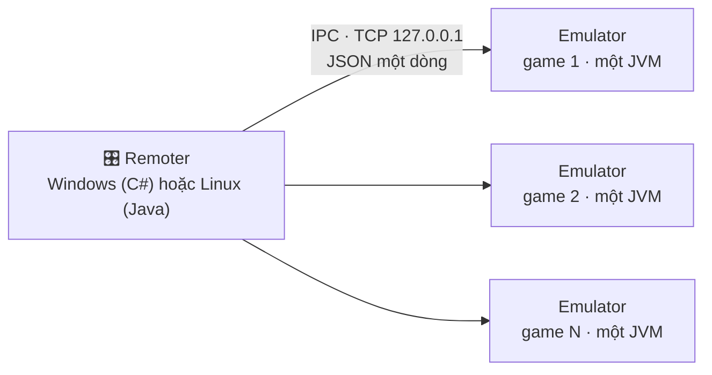

<div align="center">

# 🎮 Che779 Emulator + Remoter

**Giả lập J2ME cho Windows và Linux: mỗi tab là một cửa sổ game riêng, điều khiển tập trung bằng Remoter.**

Emulator (Java) chạy từng game trong một tiến trình riêng; Remoter mở, sắp xếp và đồng bộ tất cả các cửa sổ đó.
Có Remoter cho **Windows** (C#) và cho **Linux** (Java).

[](../../releases/latest)
[](../../releases)
[](../../actions)
[](#-tải-về)
[](#-tải-về)
[](#-yêu-cầu-hệ-thống)
[](LICENSE)

[Tải về](#-tải-về) · [Tính năng](#-tính-năng) · [Bắt đầu nhanh](#-bắt-đầu-nhanh) · [Hướng dẫn](#-hướng-dẫn-sử-dụng) · [Hỏi đáp](#-hỏi-đáp-và-xử-lý-lỗi) · [Build](#-build-từ-mã-nguồn) · [Tài liệu](#-tài-liệu) · [Ghi công](#-ghi-công-và-giấy-phép)

</div>

---

## 📥 Tải về

Vào mục **[Releases](../../releases/latest)** và tải đúng file cho hệ điều hành của bạn:

| Hệ điều hành | File cần tải | Bên trong có gì |
|---|---|---|
| 🪟 **Windows** | `Che779-Emulator-<phiên bản>-Windows.zip` | `Che779_Emulator.jar` + `Che779_Remoter.exe` |
| 🐧 **Linux** | `Che779-Remoter-<phiên bản>-Linux.zip` | `Che779_Emulator.jar` + `Che779_Remoter.jar` + `chay.sh` |

Giải nén ra **một thư mục**, giữ hai file cạnh nhau. Mỗi bản phát hành có kèm `SHA256SUMS.txt` để bạn kiểm tra file tải về có nguyên vẹn không:

```bash
sha256sum -c SHA256SUMS.txt        # Linux
Get-FileHash <file>.zip -Algorithm SHA256   # Windows PowerShell
```

> Chưa thấy file nào ở Releases? Bản phát hành được tạo tự động khi chủ dự án gắn thẻ phiên bản. Trong lúc đó bạn có thể [tự build](#-build-từ-mã-nguồn).

---

## 🌐 Hệ sinh thái Che779

Che779 gồm 4 dự án, mỗi dự án một repo. Bạn đang xem **Project 1**.

| # | Dự án | Chạy trên | Dùng khi nào |
|:-:|---|---|---|
| 1 | **Che779-Emulator** ← *bạn đang ở đây* | Windows, Linux | Mỗi tab một cửa sổ, điều khiển bằng Remoter |
| 2 | [**Che779-EmulatorV2**](https://github.com/Kidtomboy/Che779-EmulatorV2) | Windows / Java 8+ | Nhiều tab trong một cửa sổ, một tiến trình |
| 3 | [**Che779-Linux**](https://github.com/Kidtomboy/Che779-Linux) | Linux và Termux | Một lệnh cài và chạy trên Linux / Android (Termux) |
| 4 | [**Che779-Android**](https://github.com/Kidtomboy/Che779-Android) | Android | Chạy trực tiếp trên điện thoại bằng APK |

> 📌 Tên repo này từng là tên của bản Android. Bản Android nay nằm ở **Che779-Android**; các link cũ vẫn tự chuyển hướng.

**Nên chọn Project 1 hay Project 2?** Project 1 cho mỗi game một tiến trình riêng nên một game treo không kéo sập game khác, đổi lại tốn RAM hơn. Project 2 gom mọi tab vào một cửa sổ nên nhẹ và gọn hơn.

---

## ✨ Tính năng

### Emulator (Java)

| | Tính năng | Mô tả |
|:-:|---|---|
| 🧹 | **Clean RAM** | Dọn bộ nhớ qua JNA; không có JNA thì dùng PowerShell (Windows) |
| 😴 | **Sleep (F12)** | Ngủ thủ công hoặc tự ngủ khi rảnh |
| 🎞️ | **Giảm FPS, giảm đồ họa** | Tiết kiệm CPU khi treo nhiều game |
| ⏩ | **Tốc độ game** | Chỉnh theo bước 0,1 |
| 🔀 | **Thay IP máy chủ** | `server.txt` trong jar game → máy chủ chọn từ `servers.txt` (`ip\|port\|tên`, có thể tải từ URL) → tự nhập |
| 🌐 | **Quản lý Proxy** | HTTP (có xác thực) và SOCKS5 |
| 🔌 | **IPC** | Cho chương trình khác điều khiển qua TCP `127.0.0.1` |

### Remoter Windows (C#)

| | Tính năng | Mô tả |
|:-:|---|---|
| 🗂️ | **Quản lý nhiều tab** | Mở, dừng, mở lại; bảng theo dõi cổng, CPU, RAM, trạng thái ngủ, PID |
| 🔲 | **Tự sắp xếp** | Xếp cửa sổ theo lưới (chọn số cột, hàng); Hiện lại từng tab về đúng vị trí cũ |
| ⌨️ | **Đồng bộ phím + bàn phím ảo** | Một phím nhấn được nhân ra các tab |
| 🖱️ | **Đồng bộ chuột** | Nhấp và kéo ở một tab được nhân ra các tab khác, theo tọa độ tỉ lệ |
| ⏺️ | **Macro phím** | Ghi rồi phát lặp |
| 📸 | **Chụp màn hình** | Chụp từng tab |
| ⏱️ | **Hẹn giờ, tự mở lại** | Hẹn giờ đóng tab; tự mở lại tab khi thoát |
| 💾 | **Hồ sơ `.che779`** | Lưu và nạp toàn bộ cấu hình; tách dữ liệu từng tab; giao diện tối |

### Remoter Linux (Java/Swing)

| | Tính năng | Mô tả |
|:-:|---|---|
| 🗂️ | **Quản lý tab** | Mở, đóng, mở lại; Hiện/Ẩn, Ngủ/Thức, dọn RAM |
| 🌐 | **Proxy** | Đặt `host:port[:user:pass]` cho các tab đang chọn |
| 🖼️ | **Khung xem trước** | Chuột và phím thao tác ở đây được nhân ra các tab đã tick |
| 📸 | **Chụp màn hình** | Lưu ảnh tab đang chọn |

Remoter Linux gọn hơn bản Windows: **chưa có** xếp cửa sổ, xem lưới, quản lý proxy hàng loạt, macro, hẹn giờ, hồ sơ. Đồng bộ chuột/phím làm ở khung xem trước chứ không hook toàn cục vào cửa sổ game (Linux không cho làm dễ dàng).

---

## 🖥️ Yêu cầu hệ thống

| | Windows | Linux |
|---|---|---|
| Hệ điều hành | Windows có .NET Framework 4.8 | Bất kỳ distro nào có Java và màn hình đồ họa (X11 hoặc Wayland) |
| Java | **Java 8 trở lên** | **Java 8 trở lên** |
| RAM | Tùy game; mỗi tab là một JVM nên cần nhiều RAM hơn Project 2 (đặt RAM tối đa mỗi tab trong Remoter) | Như Windows |
| Màn hình | Có | Có; không có thì dùng màn hình ảo `xvfb-run` (không nhìn thấy cửa sổ) |

Cài Java trên Debian/Ubuntu/Mint bằng gói chính thức: `sudo apt install default-jre`. Windows: tải từ [Adoptium](https://adoptium.net).

---

## 🚀 Bắt đầu nhanh

**Windows**
1. Tải `…-Windows.zip`, giải nén ra một thư mục.
2. Bấm đúp **`Che779_Remoter.exe`**.
3. Chọn file game `.jar`, đặt số tab, bấm **Bắt đầu**.

**Linux**
1. Tải `…-Linux.zip`, giải nén, vào thư mục vừa giải nén.
2. Chạy `./chay.sh` (hoặc `./chay.sh /đường/dẫn/game.jar` để mở sẵn game).
3. Bấm **Mở game…**, chọn file `.jar`.

---

## 📖 Hướng dẫn sử dụng

### Remoter Windows
1. **Chọn Java và game:** nút **Duyệt** chọn `javaw.exe`/`java.exe` và file game `.jar`; **Thêm game (.jar)** để chạy nhiều game khác nhau.
2. **Bắt đầu:** đặt số tab và RAM tối đa mỗi tab. Bảng danh sách hiện trạng thái từng tab.
3. **Hành động:** Hiện/Ẩn, Ngủ, dừng, mở lại từng tab hoặc cả nhóm.
4. **Đồng bộ:** bật Đồng bộ Phím hoặc Đồng bộ Chuột để thao tác một tab lặp lại ở các tab khác. Phím thật dùng được: mũi tên, Enter = OK, F1/F2 = phím mềm, 0–9, A–Z, Space, Backspace.
5. **Hồ sơ:** lưu cấu hình thành file `.che779` để nạp lại sau (phải dừng hết tab trước khi nạp).

### Remoter Linux
| Nút | Việc |
|---|---|
| Mở game… / Mở lại / Đóng / Đóng hết | Quản lý tab |
| Hiện / Ẩn / Ngủ / Thức / Dọn RAM | Gửi tới tab đang chọn (và các tab đã tick nếu bật *Đồng bộ*) |
| Proxy… | `host:port` hoặc `host:port:user:pass`; để trống = tắt |
| Chụp… | Lưu ảnh màn hình tab đang chọn |
| Khung xem trước + bàn phím | Nhấp, kéo chuột và gõ phím ở đây để điều khiển các tab |

---

## ⚙️ Cấu hình và nơi lưu dữ liệu

| | Windows | Linux |
|---|---|---|
| Dữ liệu Emulator (cấu hình, proxy, máy chủ, RMS) | `%APPDATA%\Che779\Che779-Emulator` | `~/.che779` |
| Cấu hình Remoter | `%APPDATA%\Che779\Che779-Remoter` | `~/.che779/remoter.properties` |
| Log từng tab | — | thư mục tạm, `che779-tab<N>.log` |

Dữ liệu **không** ghi vào thư mục bạn giải nén, nên cập nhật bản mới không mất dữ liệu. Cần JNA cho Clean RAM sâu hơn? Đặt `jna.jar` vào `lib/` cạnh `Che779_Emulator.jar` (tùy chọn).

---

## 🧩 Cách hoạt động



Mỗi game chạy trong một tiến trình Java riêng, nên một game treo không ảnh hưởng game khác. Remoter nói chuyện với từng Emulator qua cổng TCP chỉ mở trên `127.0.0.1` (mặc định từ **7790**). Mỗi lệnh là một dòng JSON và nhận lại một dòng trả lời. Các lệnh: `ping`, `status`, `version`, `keypress`, `keydown`, `keyup`, `text`, `mouse`, `hide`, `show`, `sleep`, `clean_ram`, `proxy`, `proxy_get`, `screenshot`, `quit`, `close`. Chi tiết: [`docs/IPC_PROTOCOL.md`](docs/IPC_PROTOCOL.md).

Vì IPC là TCP + JSON thuần, bạn có thể tự viết công cụ điều khiển bằng ngôn ngữ khác.

---

## 🔧 Build từ mã nguồn

Cần JDK 9 trở lên (build ra bytecode Java 8). Các script build **không cần `unzip`**.

| Thành phần | Linux/macOS | Windows |
|---|---|---|
| Emulator | `apps/emulator/source/build.sh` | `build_emulator.bat` hoặc `build_emulator.ps1` |
| Remoter Windows | — | `apps/remoter-windows/source/build_remoter.bat` / `.ps1`, hoặc `dotnet build apps/remoter-windows/source/Che779Remoter.csproj -c Release` |
| Remoter Linux | `apps/remoter-linux/build.sh` (hoặc `run.sh` để build rồi chạy) | `build.cmd` hoặc `build.ps1` |

Đóng gói bản Windows ngay trên máy bạn: `scripts/package-windows.ps1`. Kiểm tra cấu trúc repo: `python tests/verify_project1.py`. Chi tiết: [`docs/BUILD_AND_RUN.md`](docs/BUILD_AND_RUN.md).

Chủ dự án phát hành bằng cách gắn thẻ `vX.Y.Z`: workflow **Phát hành** tự build, đóng gói zip và tạo `SHA256SUMS.txt`.

---

## ❓ Hỏi đáp và xử lý lỗi

| Bạn gặp | Làm gì |
|---|---|
| Remoter báo *"Chưa chọn đúng file Che779_Emulator.jar"* | Để `Che779_Emulator.jar` cùng thư mục với Remoter, hoặc chọn bằng nút **Duyệt**. |
| Không mở được game | Kiểm tra đã cài Java 8+ và đã chọn đúng `javaw.exe`/`java` trong Remoter. |
| Linux: Remoter không tìm thấy Emulator | Bấm **Cài đặt**, chọn `Che779_Emulator.jar`. |
| Linux: chạy qua SSH/máy chủ không có màn hình | Dùng màn hình ảo: `xvfb-run -a ./chay.sh` (không thấy cửa sổ thật). |
| Tab báo "Không phản hồi" | Thử **Mở lại**. Trên Linux xem `che779-tab<N>.log` trong thư mục tạm. |
| Game không vào được mạng | Thử đổi máy chủ hoặc đặt proxy trong menu **Che779** của Emulator. Lỗi mạng còn có thể do chính máy chủ game. |
| Muốn báo lỗi | Mở [Issue](../../issues/new/choose), ghi phiên bản (nút **Phiên bản** trong Remoter), hệ điều hành và Java. Xóa mật khẩu proxy khỏi log. |

---

## ⚠️ Giới hạn và vấn đề đã biết

- Remoter Windows chỉ chạy trên Windows (dùng WinForms và API Windows).
- Mỗi tab là một JVM nên **tốn RAM hơn** Project 2.
- **IPC chưa có xác thực:** tiến trình khác trên cùng máy biết cổng thì gửi được lệnh. Không mở cổng này ra mạng. Xem [`SECURITY.md`](SECURITY.md).
- Mật khẩu proxy được lưu và truyền dạng chữ thường.
- Clean RAM trên Windows chỉ thu nhỏ vùng nhớ hiển thị của tiến trình, không giải phóng bộ nhớ Java thật.
- Đồng bộ chuột của Remoter Windows theo tọa độ cả cửa sổ; các tab nên cùng kích thước để trùng vị trí.
- Remoter Linux mới chạy thử dưới màn hình ảo, chưa thử với trình quản lý cửa sổ thật hay Wayland.

Phần nào đã kiểm chứng, phần nào chưa: [`docs/TESTING.md`](docs/TESTING.md).

---

## 🗂️ Cấu trúc repo

```
Che779-Emulator/
├─ README.md  CONTRIBUTING.md  SECURITY.md  LICENSE  CHANGELOG.md  VERSION
├─ apps/
│  ├─ emulator/          Emulator (Java) — source/ và prebuilt/
│  ├─ remoter-windows/   Remoter Windows (C#) — source/
│  └─ remoter-linux/     Remoter Linux (Java/Swing)
├─ docs/                 Tài liệu kỹ thuật (có mục lục)
├─ scripts/              Đóng gói bản Windows
├─ tests/                Kiểm tra cấu trúc repo
├─ LICENSES/             Giấy phép bên thứ ba
└─ .github/              Workflow CI + Phát hành, mẫu Issue và Pull Request
```

---

## 📚 Tài liệu

[Mục lục](docs/README.md) · [Trạng thái](docs/PROJECT_STATE.md) · [Kiến trúc](docs/ARCHITECTURE.md) · [IPC](docs/IPC_PROTOCOL.md) · [Build và chạy](docs/BUILD_AND_RUN.md) · [Kiểm thử](docs/TESTING.md) · [Lỗi đã biết](docs/DEBUG_LOG.md) · [Quyết định](docs/DECISIONS.md) · [Lộ trình](docs/ROADMAP.md) · [Fork và bản tự build](docs/VARIANTS_AND_CLONES.md) · [Nguồn gốc mã](docs/SOURCE_INVENTORY.md) · [Bàn giao](docs/AI_HANDOFF.md)

---

## 🤝 Đóng góp và bảo mật

Muốn góp sức? Đọc [`CONTRIBUTING.md`](CONTRIBUTING.md). Tìm thấy lỗ hổng bảo mật? Xem [`SECURITY.md`](SECURITY.md) và báo riêng, đừng đăng công khai.

---

## 🙏 Ghi công và giấy phép

Emulator dựa trên **[MicroEmulator](https://github.com/barteo/microemu)** 3.0.0 (Apache License 2.0); Remoter lấy cảm hứng từ ZMicroPro. Giữ nguyên thông báo bản quyền khi phân phối lại; xem [`LICENSE`](LICENSE) và thư mục [`LICENSES/`](LICENSES).

<div align="center">

Làm bởi **Cherry** · [Báo lỗi](../../issues/new/choose) · [Đóng góp](CONTRIBUTING.md) · [Bảo mật](SECURITY.md)

</div>
