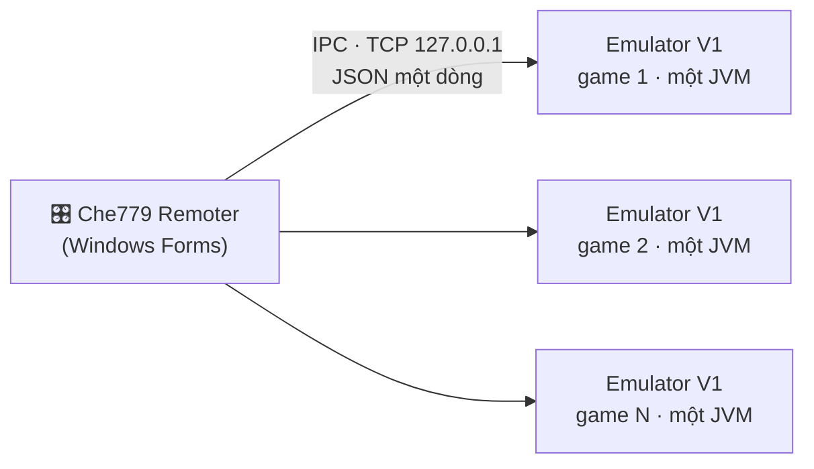

<div align="center">

# 🪟 Che779 Emulator + Remoter

**Giả lập J2ME cho Windows: mỗi tab là một cửa sổ riêng, điều khiển tập trung bằng Remoter.**

Emulator V1 (Java) chạy từng game trong một tiến trình riêng; Remoter (C#) mở, sắp xếp và đồng bộ tất cả các cửa sổ đó.

[](#-chạy-cùng-nhau)
[](#-chạy-cùng-nhau)
[](CHANGELOG.md)
[](LICENSE)
[](#-trạng-thái-và-giới-hạn)

[Tính năng](#-tính-năng) · [Chạy](#-chạy-cùng-nhau) · [Build](#-build) · [IPC](#-ipc) · [Cấu trúc](#-cấu-trúc-repo) · [Tài liệu](#-tài-liệu) · [Ghi công](#-ghi-công-và-giấy-phép)

</div>

---

## 🌐 Hệ sinh thái Che779

Che779 gồm 4 dự án, mỗi dự án một repo. Bạn đang xem **Project 1**.

| # | Dự án | Chạy trên | Dùng khi nào |
|:-:|---|---|---|
| 1 | **Che779-Emulator** ← *bạn đang ở đây* | Windows | Mỗi tab một cửa sổ, điều khiển bằng Remoter |
| 2 | [**Che779-EmulatorV2**](https://github.com/Kidtomboy/Che779-EmulatorV2) | Windows / Java 8+ | Nhiều tab trong một cửa sổ, một tiến trình |
| 3 | [**Che779-Linux**](https://github.com/Kidtomboy/Che779-Linux) | Linux và Termux | Gói chạy trên Linux và Android (Termux) |
| 4 | [**Che779-Android**](https://github.com/Kidtomboy/Che779-Android) | Android | Chạy trực tiếp trên điện thoại bằng APK |

> 📌 Repo này từng là tên của bản Android. Bản Android nay nằm ở **Che779-Android**; các link cũ vẫn tự chuyển hướng.

---

## 🧩 Hai ứng dụng, một sản phẩm



Mỗi game chạy trong một tiến trình Java riêng, nên một game treo không ảnh hưởng các game khác. Đổi lại, nhiều tab thì tốn RAM hơn bản V2.

---

## ✨ Tính năng

### Emulator V1

| | Tính năng | Mô tả |
|:-:|---|---|
| 🧹 | **Clean RAM** | Dọn bộ nhớ qua JNA; không có JNA thì dùng PowerShell |
| 😴 | **Sleep (F12)** | Ngủ thủ công hoặc tự ngủ khi rảnh |
| 🎞️ | **Giảm FPS / giảm đồ họa** | Tiết kiệm CPU khi treo nhiều game |
| ⏩ | **Tốc độ game** | Chỉnh theo bước 0,1 |
| 🔀 | **Thay IP máy chủ** | `server.txt` trong jar game → máy chủ chọn từ `servers.txt` (`ip\|port\|tên`, có thể tải từ URL) → tự nhập |
| 🌐 | **Proxy** | HTTP (có xác thực) và SOCKS5 |

### Remoter

| | Tính năng | Mô tả |
|:-:|---|---|
| 🪟 | **Quản lý nhiều cửa sổ** | Mở, đóng, khởi động lại từng tab; Hiện/Ẩn trả về đúng vị trí cũ |
| 🔲 | **Sắp xếp và xem lưới** | Xếp cửa sổ gọn lại, xem nhiều tab cùng lúc |
| 🖱️ | **Đồng bộ chuột** | Nhấp và kéo ở một cửa sổ được nhân ra các tab, theo tọa độ tỉ lệ |
| ⌨️ | **Bàn phím ảo** | Gửi phím tới các tab |
| 🧾 | **Quản lý proxy** | Thêm hàng loạt, kiểm tra; chế độ: không can thiệp / tắt / một proxy chung / mỗi tab một proxy xoay vòng |

Dữ liệu lưu ở `%APPDATA%\Che779\Che779-Emulator` và `%APPDATA%\Che779\Che779-Remoter`, không ghi vào thư mục giải nén.

---

## ▶️ Chạy cùng nhau

1. [Build](#-build) hoặc lấy sẵn `Che779_Emulator.jar` và `Che779_Remoter.exe`.
2. Đặt `Che779_Emulator.jar` **cạnh** `Che779_Remoter.exe` (Remoter tự dò), hoặc chọn đường dẫn trong Remoter.
3. Chọn Java (`javaw.exe` / `java.exe`) và file game `.jar` trong Remoter.
4. Bấm mở tab game.

Phải dùng **cặp cùng phiên bản** (cả hai `0.0.0.2`): giao thức IPC giữa hai bên phải khớp nhau.

---

## 🔧 Build

**Emulator** (Linux/macOS/Git Bash):

```bash
cd apps/emulator/source
./build.sh
```

Windows: `build_emulator.bat` trong cùng thư mục. JAR ra ở `apps/emulator/source/Che779_Emulator.jar`. Cần JDK 9 trở lên (biên dịch ra bytecode Java 8).

**Remoter** (Windows):

```powershell
dotnet build apps/remoter/source/Che779Remoter.csproj -c Release
```

Hoặc chạy `build_remoter.bat` trong `apps/remoter/source` nếu có `csc.exe` .NET Framework 4.8.

Kiểm tra bộ đọc IPC: `cd apps/emulator/source && ./run-ipc-tests.sh`.

---

## 🔌 IPC

Emulator mở cổng chỉ trên `127.0.0.1`, mặc định từ **7790**. Mỗi lệnh là một dòng JSON và nhận lại một dòng trả lời. Các lệnh hiện có: `ping`, `status`, `version`, `keypress`, `keydown`, `keyup`, `text`, `mouse`, `hide`, `show`, `sleep`, `clean_ram`, `proxy`, `proxy_get`, `screenshot`, `quit` / `close`.

Chi tiết và quy tắc tương thích: [`docs/IPC_PROTOCOL.md`](docs/IPC_PROTOCOL.md). Chưa có xác thực: tiến trình khác trên cùng máy biết cổng thì gửi được lệnh.

> 💡 Vì IPC là TCP + JSON thuần, có thể viết công cụ điều khiển bằng ngôn ngữ khác để chạy trên Linux. Xem [Che779-Linux](https://github.com/Kidtomboy/Che779-Linux).

---

## 🗂️ Cấu trúc repo

| Đường dẫn | Vai trò |
|---|---|
| `apps/emulator/source/` | Mã Java, tài nguyên, script build của Emulator |
| `apps/emulator/prebuilt/` | JAR có sẵn từ gói đầu vào (bản gốc, không phải build mới) |
| `apps/remoter/source/` | Mã C#, file project, script build của Remoter |
| `docs/` | Kiến trúc, IPC, build, kiểm thử, quyết định, roadmap |
| `tests/` · `scripts/` | Kiểm tra cấu trúc · đóng gói hai ứng dụng |
| `.github/workflows/` | CI build từng ứng dụng và đóng gói chung |

---

## 🧭 Trạng thái và giới hạn

- ✅ Emulator **build được** bằng OpenJDK 21 (bytecode Java 8). JAR có sẵn trong `apps/emulator/prebuilt/` đã được chạy thử trên Linux với màn hình ảo và mở được game thật; các lệnh IPC `ping`, `status`, `version`, `keypress`, `hide`/`show`, `screenshot`, `proxy_get` đã được thử và phản hồi đúng.
- ⚠️ **Remoter chưa được build** trong môi trường rà soát (không có trình biên dịch C#), nên chưa kiểm chứng chạy.
- ⚠️ Chưa thử runtime trên Windows; chưa kiểm chứng đồng bộ chuột và proxy bằng game thật.
- Đồng bộ chuột hiện chỉ theo dõi nút trái và tọa độ theo cả cửa sổ (không riêng vùng game).
- Remoter chỉ chạy trên Windows (dùng WinForms và API Windows).

Phần nào đã xác minh, phần nào chưa: [`docs/PROJECT_STATE.md`](docs/PROJECT_STATE.md).

---

## 📚 Tài liệu

[Trạng thái](docs/PROJECT_STATE.md) · [Kiến trúc](docs/ARCHITECTURE.md) · [IPC](docs/IPC_PROTOCOL.md) · [Build và chạy](docs/BUILD_AND_RUN.md) · [Kiểm thử](docs/TESTING.md) · [Vấn đề đã biết](docs/DEBUG_LOG.md) · [Quyết định](docs/DECISIONS.md) · [Clone và biến thể](docs/VARIANTS_AND_CLONES.md) · [Roadmap](docs/ROADMAP.md) · [Bàn giao](docs/AI_HANDOFF.md) · [Kiểm kê nguồn](docs/SOURCE_INVENTORY.md)

---

## 🙏 Ghi công và giấy phép

Emulator dựa trên **[MicroEmulator](https://github.com/barteo/microemu)** 3.0.0 (Apache License 2.0); Remoter lấy cảm hứng từ ZMicroPro. Xem [`LICENSE`](LICENSE) và [`LICENSES/`](LICENSES) để biết thông báo bên thứ ba.

<div align="center">

Làm bởi **Cherry** · [Báo lỗi](../../issues) · [Đóng góp](CONTRIBUTING.md) · [Bảo mật](SECURITY.md)

</div>
